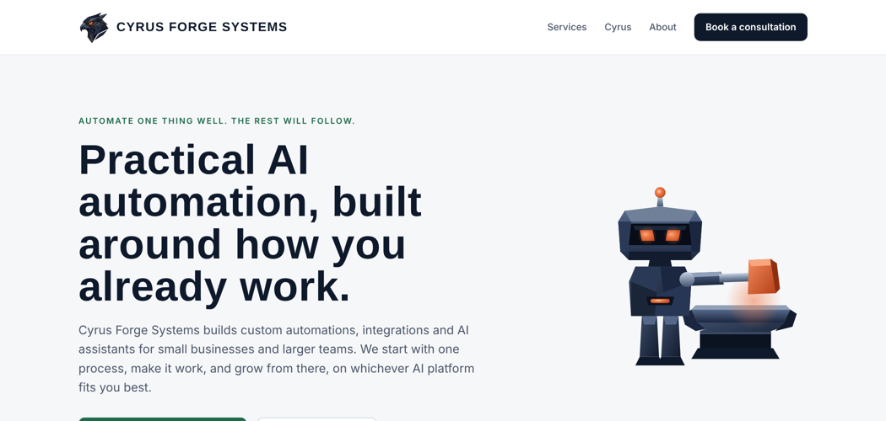

# Cyrus Forge Systems  -  website

The public site for [Cyrus Forge Systems, LLC](https://cyrusforgesystems.com), an AI automation consultancy in Fort Worth, Texas.

> **Automate one thing well. The rest will follow.**

## What's here

| Page | Path | Purpose |
|---|---|---|
| Home | `index.html` | Services, how we work, about, contact |
| Cyrus | `cyrus/index.html` | Our sports-analytics product line |
| NFL Predictor | `cyrus/nfl-predictor/index.html` | This week's projections and the running accuracy record |

- **No frameworks, no build step.** Plain HTML, one stylesheet, one small script. The whole site is under 500 KB including the animated logo.
- **Data-driven projections page.** `data/latest.js` is the only file that changes each week. It is written by the [Cyrus NFL Analytics](https://github.com/Ibmcleaner/cyrus-nfl-analytics) pipeline and rendered by `assets/predictor.js`.
- **Animated brand.** The hawk in the header is a short silent video loop (`assets/hawk-loop.*`); the "Smith" mascot on the home page is an inline SVG with CSS animation. Both respect the visitor's reduce-motion setting where it applies.
- **Accessible by default.** Semantic HTML, skip link, keyboard-operable tabs, visible focus states.

## How it's deployed

Hosted on **Cloudflare Pages** (direct upload) with Cloudflare DNS and Email Routing for `contact@cyrusforgesystems.com`.

To deploy a change: zip the contents of this folder (not the folder itself) and upload it as a new Production deployment in the Cloudflare dashboard.

## Weekly update flow

1. The Cyrus NFL Analytics pipeline runs Wednesday and Friday at 6:45 PM Central.
2. It downloads the current site package from Google Drive, replaces `data/latest.js` with the week's card and record, and produces a new zip.
3. The zip is uploaded to Cloudflare Pages.

Nothing else on the site changes between weeks, so the design and copy stay under version control here.

## How it was built

Built in one day, October 25, 2026, from a blank folder to a live domain, then refined over the following days. The constraint was deliberate: no frameworks, no build tools, nothing a future maintainer would have to learn. Plain HTML, one stylesheet, one script.

### The sequence

1. **Structure first.** Three pages were mapped before any design: Home (what the company does), Cyrus (the product line), and the NFL Predictor (a page that renders a data file). The predictor page was designed so that only `data/latest.js` changes week to week, which is what makes the weekly automation possible.
2. **Copy before chrome.** The About section went through two drafts. The first was lifted from a resume and read like one. The second was rewritten as a formal company statement: nearly 30 years in telecom and enterprise systems, Fortune 500 experience, credentials in AI, SQL, Tableau, Python and AWS, and the line that became the site's point of view: automation only succeeds when it fits the people who use it.
3. **Hosting and email in an afternoon.** Cloudflare Pages (free tier, direct zip upload), DNS moved from Namecheap to Cloudflare, and Cloudflare Email Routing so contact@ and rob@ forward to an existing mailbox at no cost. Two mistakes along the way: the first deploy went out with placeholder text because every version of the zip had the same file name (fixed by naming each package uniquely), and a README was published as a public page (removed from the package).
4. **Odds came out.** The public predictor originally showed fair odds and a value column. The founder cut them: the product is a prediction judged on right or wrong, not a wagering tip. The tables were rebuilt around the call, Cyrus's projection and the casino line.
5. **Brand, five rounds.** Logo concepts were produced in five rounds by two AI models under one written brief that named the inspirations (Paul Rand and Eliot Noyes; OpenAI's brand team) and listed what to avoid. Flat, minimal marks were rejected as too basic for the brand's taste. The winner was a faceted metallic hawk from Gemini, chosen because it read as professional and not obviously AI-made. The mascot, "the Smith," a robot blacksmith striking code out of an anvil, was drawn as an inline SVG with CSS animation so it costs nothing to load.
6. **Motion, carefully.** The founder asked whether the hawk could periodically turn to face the visitor. A flat image cannot, so a CSS tilt was tried first; it was replaced when Gemini rendered a short 3D turn. That clip was cropped, silenced, shrunk to about 200 KB and played forward-then-backward so it loops without a snap. Autoplay is muted and inline, which is what phones require.
7. **Version control, last.** The site was published before it was in GitHub. This repository fixes that; the next step is deploying from it automatically.

### Decisions worth recording

- **A data file, not a backend.** The picks page could have called an API. Writing a static `latest.js` instead means the site has no server, no keys and no running costs, and the weekly job can update it by replacing one file.
- **Web fonts, nothing else external.** Google Fonts is the only third-party request. No analytics, no trackers, no cookie banner needed.
- **Honest footer.** The Cyrus pages carry a plain disclaimer: not a sportsbook, estimates not guarantees, legal-age notice and the problem-gambling line. It was written before the first projection was published, not after.

### Working with multiple AIs

Claude wrote the site, the copy drafts and the automation; Gemini produced the hawk logo and its animation; the same logo brief went to several models for competing ideas, each with a short role prompt first. The founder made every design call, including rejecting several rounds of work that was technically fine but did not match the brand he wanted. That rejection loop is part of the method, not a failure of it.

## Local preview

Open `index.html` in a browser. There is nothing to install.

## License

Code is MIT licensed (see `LICENSE`). The Cyrus Forge Systems name, hawk logo and mascot are trademarks of Cyrus Forge Systems, LLC and are not covered by the license.
